# Pawgress Architecture & Sequence Diagrams

この文書は **Pawgress の実装構成（レイヤー構成・ドメインモデル・状態遷移・主要シーケンス）** を図で記録します。

対応する他文書:

```text
docs/product-spec.md     — プロダクト仕様（画面、操作、データ、MVP範囲）
docs/ux-spec.md          — 情報設計 / interaction / user flow
```

**目次**

- 0. 保守方針
- 1. レイヤーアーキテクチャ
- 2. Today Lifecycle 状態遷移
- 3. 主要ドメインモデル
- 4. 主要シーケンス図
  - 4.1 起動時復元
  - 4.2 Setup→Active
  - 4.3 Active→Review→Done
  - 4.4 Today Doneの取り消し/やめる
  - 4.5 REST
  - 4.6 Inbox capture
  - 4.7 Settings変更
- 5. Navigation / Route 一覧
- 6. 永続化マップ

---

## 0. 保守方針（このドキュメントへの追従ルール）

このドキュメントは実装から自動生成されません。**コードを変更したら、該当する図を同じコミット（または直後のコミット）で更新します。**

以下の変更をした場合は、対応する節を更新してください。

| 変更内容 | 更新する節 |
|---|---|
| `router.tsx` に新しい route を追加/削除した | §1 レイヤーアーキテクチャ、§4 のシーケンス図 |
| `dailyLifecycleReducer` に新しい action を追加/変更した | §3 ドメインモデル、§4.2〜§4.5、§5 |
| `DailyLifecycleState` / `SettingsState` のフィールドを変更した | §3 ドメインモデル |
| Today の lifecycle state（setup/active/rest 以外）を追加した | §2 状態遷移図 |
| `app/persistence/` の永続化対象・キーを変更した | §4.1、§6 永続化マップ |
| 新しい feature（画面カテゴリ）を追加した | §1 レイヤーアーキテクチャ |
| featureディレクトリの内部規約（`routes/`・`<Screen>/components/`）を変更した | §1 レイヤーアーキテクチャ |

Mermaid のコードブロックは GitHub / GitLab 上でそのままレンダリングされます。新しい図を追加する場合も Mermaid 記法に統一し、スクリーンショットや外部ツール生成画像は使いません（テキストdiffでレビューできる状態を保ちます）。

---

## 1. レイヤーアーキテクチャ

`app → features → domain → shared` の一方向 import のみを許可します（`eslint-plugin-boundaries` で強制、`eslint.config.js` 参照）。`features` は `app/state/` 配下の context（`app-state`）のみ例外的に消費できますが、`app/router` ・`app/providers` の実装には立ち入りません。

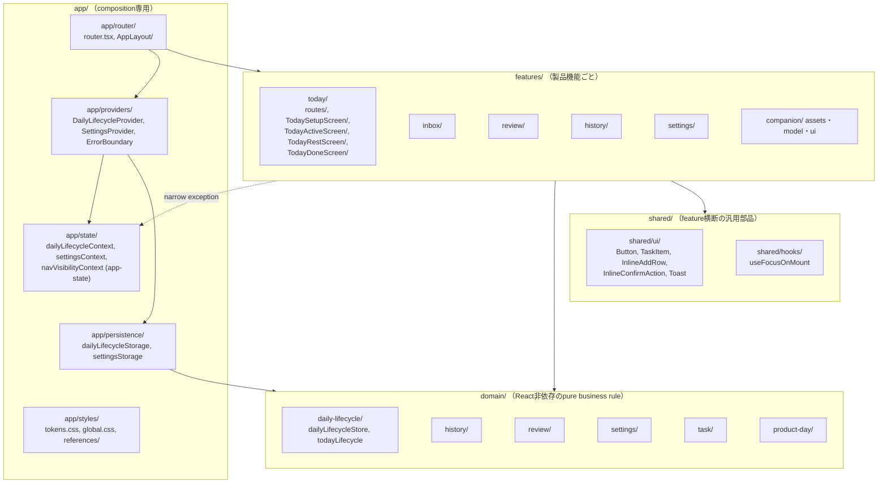

**featureディレクトリの内部規約**:

- router.tsxから直接呼ばれるRoute componentは、route数に関わらず必ず `<feature>/routes/` に置きます（例: `today/routes/TodayRoute.tsx`、`settings/routes/`配下の8ファイル）。
- 1つのscreenからしか使われないsub-component（co-locateするファイルがcss/test/story含め2〜3個程度のもの）は、個別のfolderを作らずそのscreenの `components/` へ畳み込みます（例: `today/TodaySetupScreen/components/RestAction.tsx`）。screen自身のファイルとprivate helperを同じ階層に混在させないための分離であり、複数のscreenから使われるようになった時点でこの規約から外し、shared/uiかfeature直下へ引き上げます。

---

## 2. Today Lifecycle 状態遷移

`TodayRoute`（`src/features/today/routes/TodayRoute.tsx`）は、`lifecycleState` を `DailyLifecycleState` から導出します。専用の local state は持たず、常に `todayTasks` / `historyRecords` から導出します（route の unmount/remount に左右されないため）。

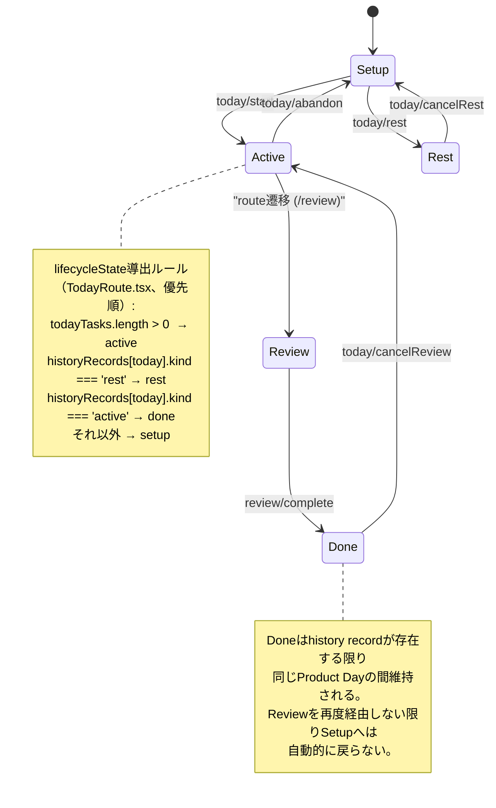

各 transition の action の詳細（発火元・効果）は §3 の action 一覧を参照してください。

---

## 3. 主要ドメインモデル

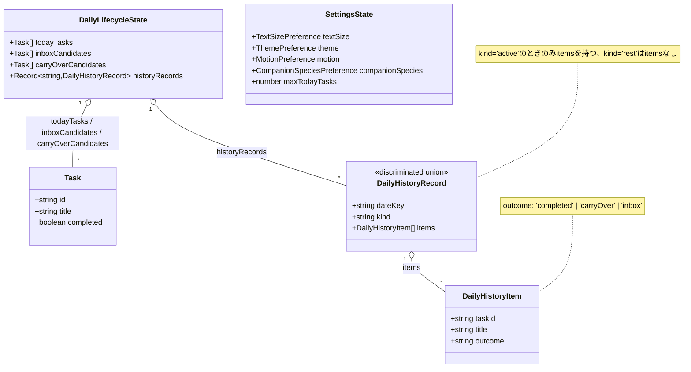

`dailyLifecycleReducer`（`src/domain/daily-lifecycle/dailyLifecycleStore.ts`）が受け付ける action 一覧:

| action type | 発火元 | 効果 |
|---|---|---|
| `inbox/appendTask` | Today Setup の Inline Add | `inboxCandidates` 末尾へ追加（capacity判定あり） |
| `inbox/prependTask` | Inbox 画面自身の capture | `inboxCandidates` 先頭へ追加（capacity判定あり） |
| `inbox/deleteTask` | Inbox 画面の削除操作 | 該当 task を `inboxCandidates` から除去 |
| `today/start` | Today Setup「今日をはじめる」 | 選択分を `todayTasks` へ、残りを `inboxCandidates` へ |
| `today/toggleTask` | Today Active のチェックボックス | 該当 task の `completed` を反転 |
| `today/addTask` | Today Active の Inline Add | `todayTasks` 末尾へ直接追加（capacity判定なし） |
| `today/rest` | Today Setup「今日は休む」確定 | `historyRecords[dateKey] = {kind:'rest'}` |
| `today/cancelRest` | REST 画面「休む日をやめる」 | 対象 `dateKey` の rest record を削除 |
| `review/complete` | Review「1日を終える」 | `historyRecords[dateKey]` を active record で確定、`todayTasks` を空に |
| `today/cancelReview` | Today Done「今日の完了を取り消す」 | 対象 `dateKey` の active record から `todayTasks` を完了状態込みで復元、`carryOverCandidates`/`inboxCandidates` からそのrecordが振り分けた分を取り除き、record自体を削除 |
| `today/abandon` | Today Active「今日をやめる」 | `todayTasks` を完了/未完了問わずすべて `inboxCandidates` へ（`completed`をfalseへリセット）、`todayTasks` を空に |

---

## 4. 主要シーケンス図

### 4.1 アプリ起動時の state 復元（永続化）

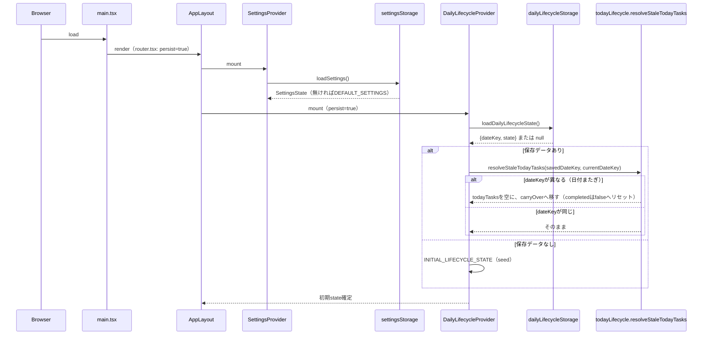

### 4.2 Today Setup → Active

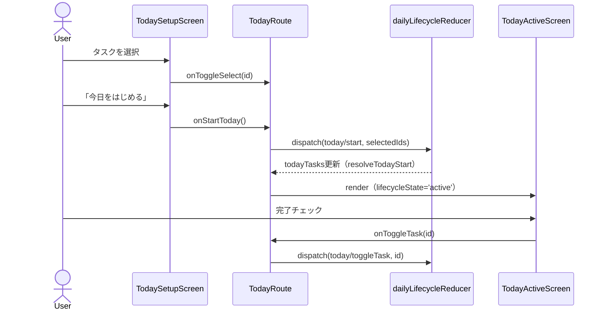

### 4.3 Today Active → Review → Done

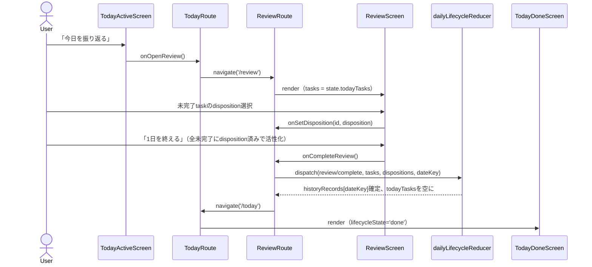

### 4.4 Today Done の取り消し / Today Active の「今日をやめる」

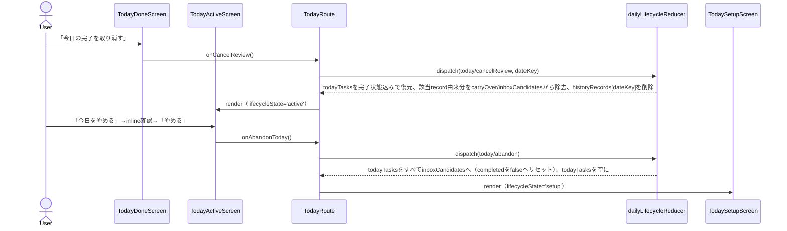

### 4.5 REST 開始・キャンセル

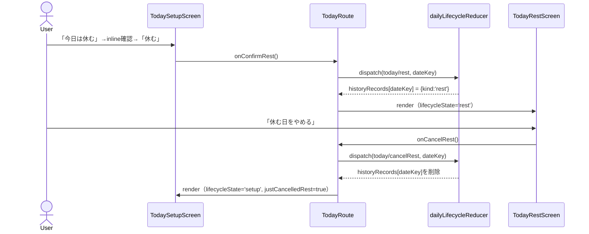

### 4.6 Inbox capture（容量制御）

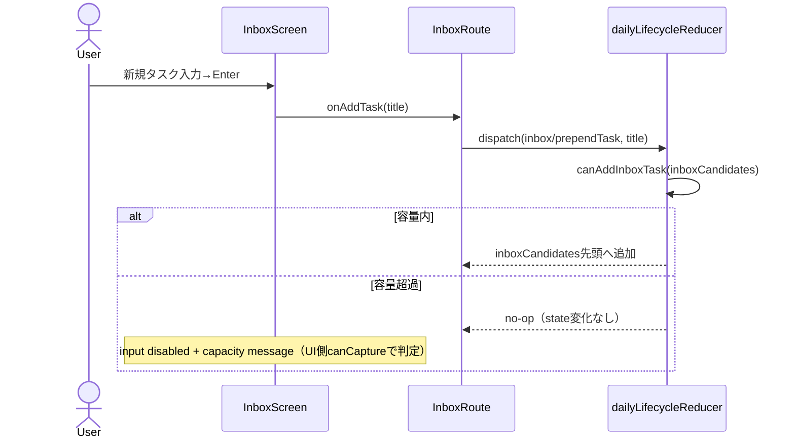

### 4.7 Settings 変更・永続化・即時反映

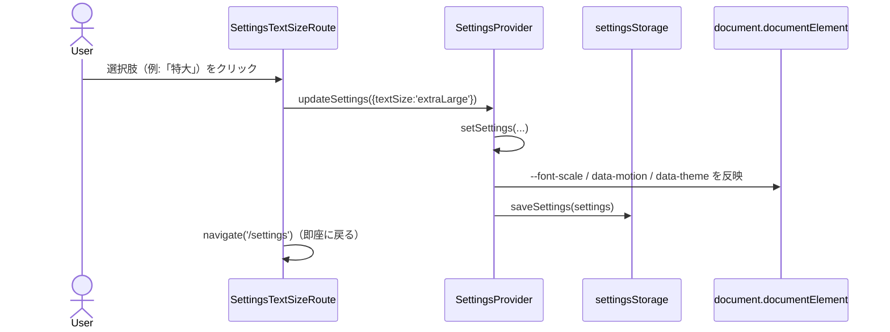

---

## 5. Navigation / Route 一覧

`router.tsx` で定義される全 route です（すべて `AppLayout` 配下）。

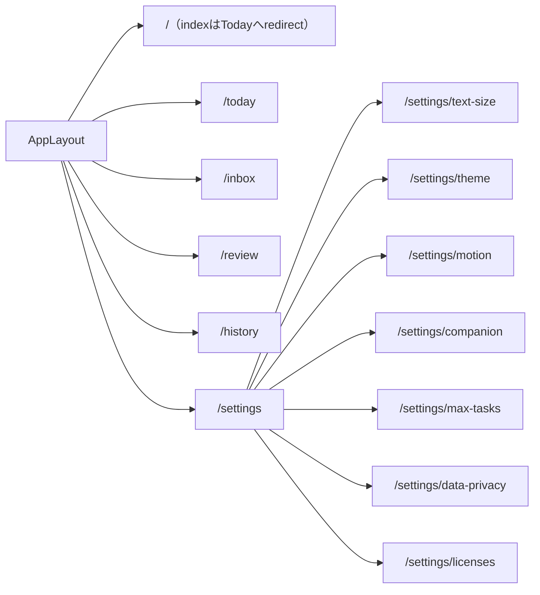

Bottom Navigation（primary）: Today / Inbox / History の3つのみ。Review・Settings は contextual/utility destination としてのみ到達します（`docs/product-spec.md` §3）。

---

## 6. 永続化マップ

`app/persistence/` 配下が、どの state を・どの key で・どこまで保存するかの一覧です。

| 対象 | storage key | 保存先 | 保存タイミング | 日付またぎ時の扱い |
|---|---|---|---|---|
| `SettingsState`（文字サイズ/テーマ/アニメーション/相棒種別/最大タスク量） | `pawgress.settings.v1` | `localStorage` | 変更の都度（`useEffect`） | 対象外（dateKeyを持たない） |
| `DailyLifecycleState`（todayTasks/inboxCandidates/carryOverCandidates/historyRecords） | `pawgress.dailyLifecycle.v1` | `localStorage` | state変化の都度（`useEffect`、`persist=true`時のみ） | `todayTasks` は `resolveStaleTodayTasks` で `carryOverCandidates` へ退避（§4.1） |

`persist` prop（`AppLayout` → `DailyLifecycleProvider`）は production entrypoint（`router.tsx`）でのみ `true` です。Storybook の `app/router/__fixtures__/*.stories.tsx` は指定せず、常に `INITIAL_LIFECYCLE_STATE` の固定 seed から始まります（再現性を優先し、localStorage には一切触れません）。

両 storage は validate + try/catch で外部境界を守ります（壊れた/旧shapeのデータは安全に初期値へ fallback）。実装は `src/app/persistence/settingsStorage.ts` / `src/app/persistence/dailyLifecycleStorage.ts` を参照してください。
