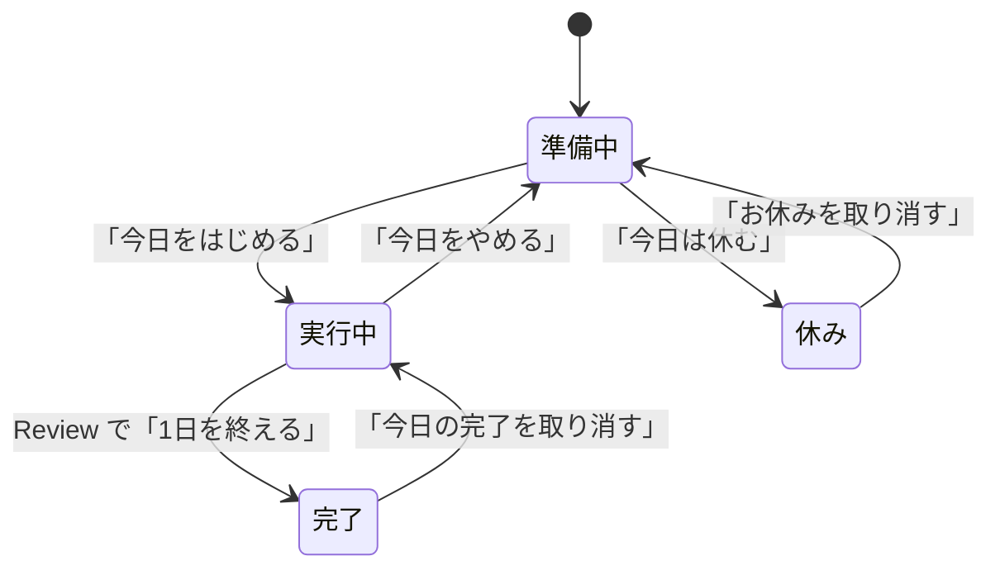

# Pawgress のしくみ（開発者以外の方向け）

この文書は、企画・デザイン・サポートなど、Pawgress に関わる開発者以外の方に向けた説明です。プログラムの知識は前提にしていません。

1章と2章は最初に通読してください。3章は画面ごとのルールの一覧なので、必要なときに該当する節だけを引いてください。4章はデータの保存先、5章は分かっている制限と未解決の問いです。

内容は、2026年10月の構造リファクタリングで調べた範囲（Today・Review・Inbox・記録・設定と、データの保存）に限ります。すべての機能を点検した文書ではありません。特に断りのない記述は、プログラムのコードで確かめた事実です。推定には【推定】、提案には【提案】と付けます。

最終更新: 2026年10月14日

## 1. 今回の変更は内部の整理だけで、使う人への影響はない

2026年10月に、リファクタリングを行いました。リファクタリングとは、外から見た動きを変えずに、プログラム内部の作りを整理することです。今回整理したのは次の点です。

- 画面下の切り替えボタン（以下 Bottom Navigation）を隠す処理を、隠す必要のある Review 画面だけが持つようにした
- Today でどの画面を出すか、何件まで選べるかの判定を、画面の部品から切り離して単独で検査できるようにした
- 設定の選択肢（文字サイズの「標準・大きめ・特大」など）の定義を1か所にまとめた
- 相棒を中心に置く5つの画面で重複していた、相棒の表示方法を1か所にまとめた
- 「Inboxがいっぱいです」という案内文を、計算のルールを置く場所から、表示する画面の側へ移した

使う人から見た画面・操作・保存されるデータの形式・URL は変わっていません。配信の方法や更新の手順といった運用も変わりません。

確認では、変更前と変更後のアプリを並べて同じ操作を実行しました。操作はタスクを選ぶ・完了する・振り返る・取り消す・休む・設定を変えるなどの19手順です。各手順で、画面の中身と保存された内容が一致することを確かめています。スマートフォン実機での操作と、画面読み上げ機能での確認はまだ行っていません【推定: 画面の中身が一致しているため変化はない見込み】。

## 2. Pawgress は「今日やることを選び、1日の終わりに振り返る」アプリ

Pawgress は、犬・猫の相棒と一緒に、その日に取り組むタスクを少数だけ選び、1日の終わりに振り返る TODO アプリです。目的と、意図的に作らない機能は `docs/product-spec.md` にまとまっています。

1日は次の順に進みます。

- **準備中**: 今日やるタスクを選ぶ
- **実行中**: 選んだタスクに取り組み、終わったものにチェックを付ける
- **Review**: 1日の終わりに、終わらなかったタスクの行き先を決める
- **完了**: その日はおしまい。記録として残る
- **休み**: その日はタスクを選ばずに休む。記録には「お休み」として残る

## 3. 画面ごとのルール（必要なときに引く）

### 3.1 今日のタスクを選ぶとき → 1件以上、設定した上限まで

- 候補は「前回からの続き」と Inbox のタスクです。この画面で新しく追加することもできます
- 選べるのは1件以上、設定の「1日の最大タスク量」まで（初期値3件、1〜5件で変更可）です。上限に達すると、ほかの候補は選べなくなります。どれかを外すと、また選べます
- 「今日をはじめる」を押すと、選んだタスクが今日のタスクになります。選ばなかった「前回からの続き」は Inbox に戻ります
- この画面で追加したタスクは、Inbox の末尾に入ります。Inbox の上限（3.5）の対象です

### 3.2 取り組んでいる途中 → チェックは何度でも付け外しでき、追加もできる

- 完了のチェックは、付けたあとでも外せます
- この画面で追加したタスクは、今日のタスクに直接入ります。「1日の最大タスク量」が効くのは選ぶときだけで、ここでの追加は制限されません
- 「今日をやめる」を押して確認すると、今日のタスクはすべて Inbox に戻り、準備中に戻ります。完了のチェックを付けていたタスクも、未完了に戻して Inbox に入ります

### 3.3 1日を振り返るとき → 終わらなかったタスクを全部振り分けるまで終われない

- 完了したタスクは一覧で確認するだけです
- 終わらなかったタスクには「明日に持ち越す」か「Inboxへ戻す」のどちらかを選びます。最初はどちらも選ばれていません
- すべて選ぶまで「1日を終える」は押せません
- 「1日を終える」を押すと、その日の記録が保存されます。持ち越したタスクは次の準備中で「前回からの続き」に、戻したタスクは Inbox に入ります
- Review の画面では、Bottom Navigation と設定ボタンを表示しません

### 3.4 終えた日・休んだ日を取り消すとき → 同じ日のうちだけ

- 「今日の完了を取り消す」を押すと、振り返る直前の実行中に戻ります。チェックの状態もそのままです。振り分けたタスクは候補から外れ、その日の記録も消えます
- 「今日は休む」は準備中のときだけ選べます。押すと確認が出ます
- 「お休みを取り消す」は確認なしですぐに取り消され、準備中に戻ります
- どちらの取り消しも、日付が変わる（3.6）と行えません

### 3.5 Inbox に入れる・消すとき → 新しく作れるのは10件まで、削除は確認なし

- Inbox 画面で追加したタスクは先頭に入ります。準備中の画面で追加したタスクは末尾に入ります
- 新しく作れるのは、Inbox が10件未満のときだけです。10件になると追加欄が使えなくなり、空きを作る方法の案内が出ます
- この10件の上限は、新しく作るときだけに効きます。Review で戻したタスク、「今日をやめる」で戻ったタスク、選ばれなかった「前回からの続き」は、10件を超えても Inbox に入ります
- 削除は確認なしで、すぐに消えます

### 3.6 日付の切り替わり → 朝4時

- 0時から3時59分までは前日として扱います
- Review をしないまま日付が変わった場合、次にアプリを開いたとき、その日のタスクは完了したものも含めて「前回からの続き」に戻ります。その日の記録は残りません
- タブを開いたまま朝4時をまたぐと、この切り替えが正しく働かない場合があります（5章の2）

### 3.7 記録（History）を見るとき → 数値の評価は出さない

- 月ごとのカレンダーで、取り組んだ日・休んだ日・記録のない日を見分けられます
- 取り組んだ日の色の濃さは、その日のタスクの数と、完了した割合から4段階で決まります
- 日付を選ぶと、その日のタスク名と結果（完了／明日に持ち越した／Inboxへ戻した）が出ます
- 未来の月には進めません。達成率や連続記録などの数値は表示しません

### 3.8 設定を変えるとき → 選んだ瞬間に反映・保存される

- 変えられるのは、文字サイズ（標準・大きめ・特大）、テーマ（端末設定・ライト・ダーク）、アニメーション（端末設定・少なくする）、相棒（犬・猫）、1日の最大タスク量（1〜5件、初期値3件）です
- 選ぶとすぐに反映・保存され、設定の一覧に戻ります
- 「データとプライバシー」の「設定を初期値に戻す」は、設定だけを戻します。タスクと記録は消えません

### 3.9 相棒 → 日付ごとに1匹が決まり、状態に合わせて様子が変わる

- 犬・猫それぞれ6種類がいて、日付ごとに1匹が決まります。同じ日なら、何度開いても同じ相棒です
- 様子は状態に合わせて変わります。たとえば、今日のタスクがすべて完了すると喜び、休みの日は静かに過ごします
- 会話や、タスクについての判断はしません

### 3.10 初めて開いたとき → Inbox に例のタスクが2件ある

- 「例：牛乳を買う」「例：資料を確認する」が Inbox に入っています。不要なら削除できます

## 4. データは使う人の端末のブラウザの中だけにある

**入力**: 画面で入力したタスク名と、選択・チェックなどの操作だけです。アカウントの登録はありません。

**保存先**: ブラウザの中の保存領域（localStorage。ブラウザがサイトごとに用意する小さな保存場所）です。区画は2つあり、「タスク・Inbox・記録」と「設定」を別々に保存しています。保存は操作のたびに自動で行われます。

**外部への送信**: プログラムの中に、外部のサーバーと通信する処理はありません。

**関わる外部システム**: アプリ自体は GitHub Pages から配信しています。一度開くと、ブラウザがアプリのファイルを手元に保存します（Service Worker という仕組み）。この仕組みが保存するのはアプリのファイルだけで、タスクのデータは含みません。

**例外的な動き**:

- 保存データが壊れていて読めないときは、初めて開いたときと同じ状態（例のタスク2件）で始まります。このとき壊れたデータはすぐに上書きされ、元には戻せません。設定も同じで、読めなければ初期値で上書きされます
- ブラウザの容量不足などで保存に失敗しても、画面はそのまま動き続けます。ただし、そのときの変更は保存されません。失敗したことは画面に表示されません

**共有と削除**: データは、その端末のそのブラウザの中だけにあります。別の端末や別のブラウザとは共有されません。ブラウザのサイトデータを消すと、タスクと記録も消えます。アプリの中に、すべてのデータを消す機能や書き出す機能はありません。

## 5. 分かっている制限と未解決の問い

どれも今回の変更では直していません。直すかどうか、どう直すかにはプロダクトとしての判断が必要です。1と2は、実際に操作を再現して確かめました。

1. **1日を終えたあとにブラウザの「戻る」を押すと、その日の記録を消せてしまう。** 「1日を終える」のあとに「戻る」で振り返り画面に戻ると、タスクが0件の状態で「1日を終える」を押せます。押すと、その日の記録が「タスク0件の日」で上書きされ、完了したタスクが記録から消えます
2. **タブを開いたまま朝4時をまたいで操作すると、前日のタスクが繰り越されない。** 前日の今日のタスクが、新しい日の今日のタスクとしてそのまま残ります。3.6 の「前回からの続きに戻る」が働きません
3. **全データの削除や書き出しの手段がない。** 消すにはブラウザのサイトデータを消す必要があります。必要かどうかは未決定です
4. **保存の失敗が使う人に伝わらない。** 4章のとおり、失敗しても表示がありません
5. **準備中の画面で追加したタスクを Inbox のどこに入れるか、仕様に定めがない。** 仕様書（`docs/ux-spec.md` §7）は Inbox 画面での追加を先頭と定めています。準備中からの追加は末尾に入りますが、これが意図どおりかは仕様から読み取れません

【提案】1と2は、記録やタスクが失われる・残り続ける問題なので、優先して判断するのがよいと考えます。

## 6. 用語

| 用語 | 意味 |
|---|---|
| リファクタリング | 外から見た動きを変えずに、プログラム内部の作りを整理すること |
| Bottom Navigation | 画面下に並ぶ「今日」「Inbox」「記録」の切り替えボタン |
| 前回からの続き | Review で「明日に持ち越す」を選んだタスクなど。次の準備中で、Inbox とは別の欄に並ぶ候補 |
| 振り分け | Review で、終わらなかったタスクを「明日に持ち越す」か「Inboxへ戻す」に決めること |
| localStorage | ブラウザがサイトごとに用意する、小さなデータの保存場所 |
| Service Worker | ブラウザがアプリのファイルを手元に保存しておき、次回すばやく開けるようにする仕組み |

開発者向けの詳しい資料は `docs/refactoring-2026-10.md` と `docs/architecture.md` にあります。この文書で分からない点は、開発担当者に問い合わせてください。
