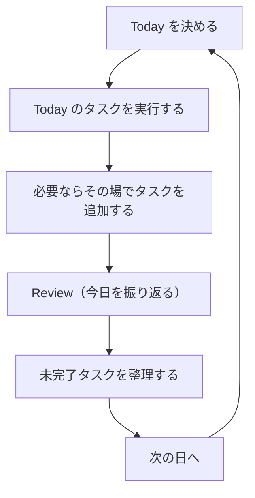

# Pawgress Product Specification

固有名詞・ライフサイクル用語の扱いについては、`docs/glossary.md` を参照してください。

## 1. Product purpose

Pawgress という名称は、Paw（動物の足、肉球）と Progress（前進）を組み合わせた造語です。

Pawgress は一般的な TODO 管理アプリではありません。今日やることを決め、少しずつ進め、終わらなかったものも責めずに次へつなぐアプリであり、犬・猫のピクセルアートの相棒と共にこの日次サイクルを続けることを目的としています。

一般的な TODO アプリは、タスクの登録・分類・優先順位付けといった準備の手間や、未完了タスクの積み重ねによる心理的な負担が大きいです。Pawgress は、タスク管理の必要性を感じながらも継続できていない人を主な対象に、この負担を減らすことを設計の出発点としています。

タスクの完了と、計画・振り返りという行動の継続を別の軸として扱います。1件も完了できなかった日でも、振り返りまで行えばその日の行動には意味があったとみなします。完了率と継続率を混同しないことが、中心的な設計原則です。

チュートリアルは必須にせず、明確なラベルと行動を促すテキストだけで説明なしに使えることを目指しています。

---

## 2. 中心となる一日の流れ

このループが Pawgress の唯一の中心的な製品フローであり、他のどの画面・機能もこれを補助する位置づけを超えません。Today を決める前に限り、「今日は休む」を選んでこのループに入らないこともできます。

---

## 3. 主な機能

- **Today** — その日に取り組むタスクを自分で選びます（デフォルト3件、Settings で1〜5件に変更可）。自動選択はしません。
- **Inbox** — Today に割り当てていないタスクの一時置き場です。溜め込みすぎを防ぐ緩やかな上限があります（既定値は `docs/ux-spec.md` §7 を参照）。
- **Review** — 1日の終わりに未完了タスクを「持ち越す」か「Inbox へ戻す」か選ぶ振り返りです。成功/失敗の判定ではありません。
- **History** — 過去の記録（read-only）です。取り組んだ日・休んだ日・記録のない日を Heatmap で振り返れますが、達成率などの数値評価は表示しません。
- **相棒** — 犬・猫のピクセルアートです。気持ちのフィードバックのみを担い、会話やタスクの判断はしません。
- **Settings** — 文字サイズ・テーマ・アニメーション・相棒の種別・1日の最大タスク量を設定する補助的な画面です。

下部のナビゲーションは Today / Inbox / History の3つです。Review と Settings は、必要なときだけ訪れる補助的な画面として扱います。

---

## 4. やらないこと

一般的な TODO アプリやタスク管理アプリにあっても、Pawgress の目的には不要なため実装しません:

- 優先度・カテゴリ・期限・ラベルによる分類
- 連続達成記録・達成率・ランキングのような生産性評価やゲーミフィケーション
- カレンダー連携・繰り返しタスク・時間ブロッキング
- チーム共同編集・SNS連携・プッシュ通知
- 相棒との会話・チャット型 AI エージェント
