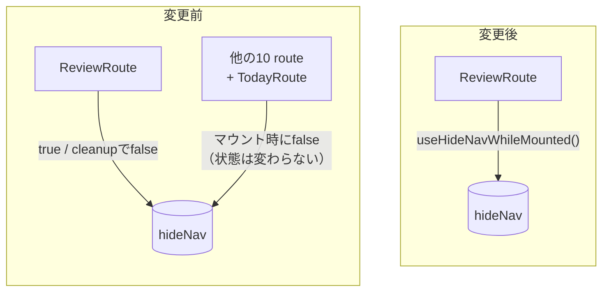
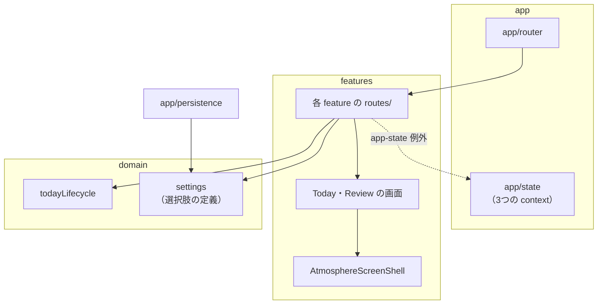

# 2026年10月 構造リファクタリングのレビュー資料

この文書は、2026年10月に行った構造リファクタリングをコードレビューする開発者向けの資料です。調査の過程をたどらなくても、変更の理由・範囲・確認済みの事項を判断できるようにまとめています。実装構成の全体像は `docs/architecture.md` にあり、ここでは今回の変更に関わる部分だけを扱います。開発者以外の方向けの説明は `docs/how-it-works.md` にあります。

## 1. 結論: 構造上の問題6件を、挙動を変えずに解消した

画面の表示・操作・保存データの形式・URL は変えていません。コードとテストの変更は8コミットで、最初の1コミットは変更前の挙動を固定する特性テスト（いまの挙動をそのまま記録し、変化を検出するためのテスト）です。このほかに、本文書を含むドキュメント更新のコミットがあります。

| # | 問題 | 対応 | コミット |
|---|---|---|---|
| 1 | features が `app/router` に逆向きに依存し、eslint の境界チェックに個別の例外を入れていた | nav 表示の context を `app/state/` へ移し、例外を削除 | `120f45f` |
| 2 | Bottom Navigation の表示を 12 route が個別に操作していた（Review 以外の11か所は状態を変えていなかった） | 隠す側の Review だけが操作する形にした | `9d094f7` |
| 3 | Today 画面の状態判定と選択上限のルールが route コンポーネントに埋まっていた | domain の純粋関数に切り出し、単体テストを追加 | `3b00f1a` |
| 4 | domain の reducer モジュールが画面の文言を持っていた | 文言を表示する画面へ移した | `ee79615` |
| 5 | 設定の選択肢が型・画面・保存値の検証の3か所に重複していた | domain の配列1か所にまとめた | `6c5b21c` |
| 6 | 相棒を中心にした5画面が、相棒の描き方を個別に持っていた | `AtmosphereScreenShell` に集約 | `5b8dcb1` |

レビューは上の表の順（コミット順）を推奨します。最初の特性テスト（`baa8034`）は変更前のコードで成功することを確認してからコミットしたもので、以降のコミットはこのテストを変更せずに通しています。コード側の最後の `3890f67` は、触れたファイルのコメントから実装経緯の記述を削っただけのコミットです。

## 2. 問題ごとの変更内容と理由

### 2.1 nav 表示の context を features が参照してよい場所へ移した（`120f45f`）

変更前、`src/app/router/navVisibilityContext.ts` を features の route 12ファイルが import していました。レイヤー規約（`app → features → domain → shared`）では features から `app/router` を参照できないため、`eslint.config.js` の `boundaries/ignore` にこのファイルだけを個別に登録して、境界チェックの対象から外していました。

features が参照してよい context は、もともと `src/app/state/`（eslint 上の `app-state`）にまとめる規約です。ファイルをそこへ移すと例外が不要になります。中身は変えていません（`git show 120f45f` で rename として表示されます）。例外を外したあとも、features から `app/router` を import すると lint エラーになることを確認しました。

### 2.2 Bottom Navigation を隠す責務を Review だけに持たせた（`9d094f7`）

変更前の流れは次のとおりでした。

- `ReviewRoute` が `useLayoutEffect` で表示中は nav を隠し、cleanup で表示に戻す
- 他の route 10件（Inbox・History・Settings 系8件）が `useShowNavOnMount()` で、マウント時に「表示」をセットする
- `TodayRoute` は同じ処理を独自の `useLayoutEffect` で書いている

Review の cleanup はアンマウント時に必ず実行されるため、Review 以外の route が表示中のとき `hideNav` は常に `false` です。したがって他の route の「表示に戻す」処理には、状態を変える場面がありませんでした。どの route にも同じ呼び出しを書く必要があるように見え、新しい route を足すときの誤解のもとになっていました。

変更後は `src/app/state/navVisibilityContext.ts` の `useHideNavWhileMounted()` を `ReviewRoute` だけが呼びます。実行タイミング（`useLayoutEffect`）と cleanup は変更前と同じです。

特性テスト（`src/features/today/routes/TodayRoute.test.tsx` の「Reviewで『1日を終える』と…」「Reviewから戻る操作で…」）で、Review を離れたあとに nav が再表示されることを確認しています。

### 2.3 Today 画面の状態判定と選択上限を純粋関数にした（`3b00f1a`）

Today は4つの画面（準備中・実行中・休み・完了）を切り替えます。どれを出すかの判定は `docs/architecture.md` §2 に優先順位つきで書かれた業務ルールです。しかし実装は `TodayRoute` 内のネストした三項演算子で、UI を通したテストでしか確認できませんでした。選択の追加・解除と上限判定（設定の最大タスク量を超えて選ばせない）も、`setState` の updater 関数の中に書かれていました。

次の3つを `src/domain/daily-lifecycle/todayLifecycle.ts` へ移しました。

- `deriveTodayLifecycleState(todayTasks, todayRecord)`: 表示する画面を返す
- `toggleTodaySelection(selectedIds, id, maxSelection)`: 選択を切り替えた新しい Set を返す（上限に達していれば追加しない）
- `MIN_TODAY_TASKS`: 最低選択数（1）

引数を `DailyLifecycleState` ではなく `todayTasks` と当日の record にしたのは、`DailyLifecycleState` を定義する `dailyLifecycleStore.ts` が `todayLifecycle.ts` を import しているためです。逆向きに import すると循環依存になります。

選択中の id（`selectedIds`）は、これまでどおり `TodayRoute` の state に残しました。`TodaySetupScreen` へ移すと、休みにしてから取り消したときに選択が消えるようになり、挙動が変わるためです。

### 2.4 容量超過時の案内文を domain から画面へ移した（`ee79615`）

`src/domain/daily-lifecycle/dailyLifecycleStore.ts` に、Inbox が満杯のときの案内文が2つ置かれていました。片方には「今日をはじめる」というボタン名が含まれており、domain 層が画面の構成を知っている状態でした。ローカルの `docs/design-decisions.md`（D-048・D-088）によると、これらの定数はもともと2画面で1つの文言を共有するために作られました。その後、画面ごとに別の文言へ分かれたため、共有する理由はなくなっていました。

文言は `InboxScreen.tsx` と `TodaySetupScreen.tsx` の JSX に直接置きました。一字一句同じです。容量の判定（`MAX_INBOX_TASKS`・`canAddInboxTask`）は業務ルールなので domain に残しています。

### 2.5 設定の選択肢を domain の1か所にまとめた（`6c5b21c`）

文字サイズ・テーマ・アニメーション・相棒の選択肢は、次の3か所に同じ値がありました。

- `src/domain/settings/settings.ts` の union 型
- 各 Settings route（`src/features/settings/routes/Settings*Route.tsx`）のローカルな `OPTIONS` 配列
- `src/app/persistence/settingsStorage.ts` の検証関数のリテラル比較

検証関数の更新を忘れると、利用者が新しい選択肢を選んで保存しても、次に開いたときに「不正な値」と判定されて設定全体が初期値に戻ります。エラーは出ません。

変更後は `TEXT_SIZE_OPTIONS` などの `as const` 配列を domain に置き、型はそこから導出します。route と検証関数はこの配列を参照します。配列の順序が選択画面の表示順になる点は変更前と同じです。

保存形式の互換性は、`src/app/persistence/settingsStorage.test.ts` の特性テストで固定しました。このテストは domain の配列を使わず、保存される文字列をそのまま列挙しています。domain 側の値を誤って変えたときに検出するためです。

### 2.6 相棒の描き方を AtmosphereScreenShell に集約した（`5b8dcb1`）

相棒を中心に置く5画面（Today の4状態と Review）は、どれも次の処理を個別に書いていました。

- 相棒の種類から雰囲気色（`getCompanionAtmospherePreset`）を求める
- 拡大率（`getCompanionVisualScale`）を求め、`calc(clamp(240px, 105vw, 420px) * 拡大率)` というサイズ式を組み立てる
- `framed={false}` を付けて `<Companion>` を描画し、外枠の `AtmosphereScreenShell` に渡す

これを `src/features/companion/ui/AtmosphereScreenShell/AtmosphereScreenShell.tsx` に移しました。各画面は `companion={{ species, variant, state }}` を渡すだけで済み、companion feature の内部モジュール（atmosphere・presentation）を知らなくてよくなりました。各画面の公開 props は変えていないため、route と Story の変更は不要です。

## 3. 変更後の依存関係

レイヤー間の依存の向き（`app → features → domain → shared`、features から `app/state` への参照だけを例外とする）は変えていません。今回の変更で、この例外の外にあった依存（features → `app/router`）がなくなりました。

今回触れたモジュールの持ち主は次のとおりです。

| モジュール | 持ち主として担うこと |
|---|---|
| `src/app/state/navVisibilityContext.ts` | Bottom Navigation の表示状態の context と、Review 用の非表示フック |
| `src/domain/daily-lifecycle/todayLifecycle.ts` | Today の画面判定・選択上限・開始・日付またぎ・完了取り消しのルール |
| `src/domain/settings/settings.ts` | 設定の型・選択肢・表示名・既定値 |
| `src/features/companion/ui/AtmosphereScreenShell/` | 相棒を中心にした画面の外枠。雰囲気色と相棒の大きさを決める |
| `src/features/today/routes/TodayRoute.tsx` | Today の state を読み、画面を選び、操作を action に変える（判定ルールは持たない） |

## 4. state の持ち主・データの流れ・外部境界

一覧は `docs/architecture.md` §7 に追記しました。今回の変更点は次の2つです。

- Bottom Navigation の表示状態を書き換える経路が `ReviewRoute` の1か所になった。持ち主（`AppLayout` 内の provider）は変わらない
- Today の画面判定は、引き続き state を持たずに毎回導出する。判定を行う場所が `TodayRoute` から domain の関数に移っただけ

データの流れ（画面 → route → reducer → provider の state → localStorage）は変えていません。外部境界（localStorage・`document.documentElement`・Service Worker など）も同じです。

## 5. 検討したが採らなかった案

**nav の表示を route 定義の `handle` で宣言する案。** React Router 7 の `handle` と `useMatches()` を使えば、`router.tsx` に「この route では nav を隠す」と書けます。採らなかった理由は2つあります。テストと Story の多くが独自に route 表を組んでいるため、それぞれに同じ `handle` を複製する必要があること。そして、インストール済みの React Router 7.18 では route 定義の `handle` が `any`、`useMatches()` で読む側が `unknown` 型のため、読む側に型ガードか型アサーションが要ることです。

**Settings の選択 route 5本を1つの汎用 route に統合する案。** 最大タスク量だけが数値と文字列の変換を持ち、相棒だけが画像とグリッド表示を持つため、汎用化すると型パラメータと分岐が増えます。各 route は21〜42行と短く読みやすいので、重複の本体である選択肢の定義だけを domain に寄せました。

**`DailyLifecycleProvider` の `persist` フラグと fixture 依存の解消。** 本番コードの `src/app/providers/DailyLifecycleProvider.tsx` が、テスト用データの置き場である `src/app/providers/__fixtures__/dailyLifecycleFixtures.ts` を import しています（`persist=false` のときの初期データ）。これを解消するには `AppLayout` の API と、それを使う多数のテスト・Story を変える必要があります。差分の大きさに比べて読みやすさの改善が小さいため、今回は見送りました。§7 の改善候補に残しています。

**`dailyLifecycleStore.ts` の改名。** 中身は reducer ですが、import している箇所が多く、名前を変えるだけの差分になるため見送りました。

**「今日の相棒」を求める処理のフック化。** 4つの route が `getDailyCompanionVariant(settings.companionSpecies, getProductDateKey())` を書いています。各2行と短く、フックにすると settings context への依存が route から見えなくなるため見送りました。

## 6. 今後の変更で守るべき制約

- Bottom Navigation を隠すのは `useHideNavWhileMounted()` を呼ぶ route だけです。他の route に「表示に戻す」処理を足す必要はありません。このフックの `useLayoutEffect` を `useEffect` に変えると、Review を開いた瞬間に nav が一度描画されてしまいます
- features から使う context は `src/app/state/` に置きます。`eslint.config.js` の `boundaries/ignore` に個別ファイルを足して境界を回避しないでください
- Today の画面判定は `deriveTodayLifecycleState` に集めます。`TodayRoute` に「いまどの画面か」を state として持たせると、route の再マウントで失われます
- 設定の選択肢を増減するときは、`src/domain/settings/settings.ts` の `*_OPTIONS` と `*_LABEL` を変えます。選択肢を削除すると、その値を保存済みの利用者は設定全体が初期値に戻ります
- `AtmosphereScreenShell` の `companion` を ReactNode で受ける形に戻すと、サイズ式の重複が5画面に戻ります
- domain に画面の文言を置かないでください。文言は表示する画面が持ちます

## 7. 検証結果と、確認できていないこと

### 7.1 変更前の状態（baseline）

変更前のコミット `1306f31` では、`npm run typecheck`・`npm test`（376件）・ビルドが成功しました。`npm run lint` と `npm run format:check` は失敗しましたが、原因はすべて未追跡のルート直下 `.vitepress/cache/`（VitePress の生成物）です。このディレクトリを除外すると lint は成功します。今回の作業前から存在する問題で、ディレクトリには触れていません。

### 7.2 変更後

| 確認 | 結果 |
|---|---|
| `npm run typecheck` | 成功 |
| `npm test` | 成功（403件。特性テスト17件と純粋関数のテスト10件を追加） |
| `npm run lint` | `.vitepress/cache/` の4件のみで失敗（変更前と同じ）。これを除外した `eslint .` は成功 |
| `prettier --check`（`.vitepress/` を除く） | 成功 |
| 本番ビルド・Storybook ビルド | 成功。JS は 512.20 kB → 511.50 kB（gzip 202.80 kB → 202.54 kB） |
| 全 Story（154件）の DOM 比較 | コミットごとに変更前と比較し、すべて一致 |
| 実ブラウザでの比較 | 変更前（`1306f31`）と変更後の本番ビルドを並べて同じ操作を実行。下記参照 |

実ブラウザでの比較には Playwright を使いました。準備中→選択→開始→完了チェック→Review→完了→Inbox への追加→記録→設定変更→再読み込み→完了の取り消し→今日をやめる→休み→休みの取り消し→Tab 移動、の19ステップです。各ステップで次の項目を比べ、すべて一致しました。

- `body` の DOM
- フォーカスのある要素
- Bottom Navigation の有無
- `<html>` の属性（文字サイズの倍率など）
- localStorage の内容（自動生成される task id は正規化して比較）

スクリーンショットは19枚中17枚がバイト単位で一致しました。残る2枚（Inbox・記録へ移った直後）は、撮影が nav の切り替え途中だったための差でした。描画が落ち着いてから撮り直すと一致しました。320px・768px・1440px のライトテーマと 390px のダークテーマでも、準備中・実行中・Review・完了の16組がすべて一致しています。

### 7.3 確認できていないこと

- 実機（iOS Safari・Android Chrome）での操作
- スクリーンリーダーでの読み上げ（DOM とフォーカス位置が一致しているので変わらない見込み。ただし未確認）
- 200% ズーム（CSS と DOM が同一なので変わらない見込み。ただし未計測）
- 開発サーバー（React の StrictMode 有効）での手動操作。StrictMode の二重実行で nav が正しく戻ることは、`useLayoutEffect` の setup と cleanup が対になっていることからの推論です
- PWA の更新・オフライン動作（今回の変更は Service Worker の設定に触れていない）

## 8. 修正せずに記録した不具合候補

今回の目的は構造の整理なので、次の2件は直していません。どちらも一時的なテストで実際に再現し、確認しました。

**Review を終えたあとに戻る操作で Review を開き直すと、その日の記録を空で上書きできる。** 「1日を終える」は `/today` へ push で遷移するため、ブラウザの「戻る」で `/review` に戻れます。このとき今日のタスクは空なので、未完了がない扱いになり「1日を終える」を押せます。押すと当日の history record が「タスク0件の取り組んだ日」で上書きされ、記録画面から完了したタスクが消えます。直し方の候補は、遷移を replace にする、Review を開ける状態を実行中に限る、reducer で既存の record を上書きしない、の3つです。どれを選ぶかにはプロダクト判断が含まれます。

**タブを開いたまま午前4時をまたいで操作すると、前日の Today のタスクが繰り越されない。** 保存時の日付は「保存した時点の日付」なので、日付が変わったあとに何か操作すると、前日のタスクが新しい日付で保存し直されます。その結果、再読み込みしても前日のタスクが今日の実行中タスクのまま残ります。`docs/architecture.md` §4.1 に書かれた「日付またぎで `carryOverCandidates` へ移す」が働きません。

もう1点、文書間の不一致があります。`AGENTS.md` §8 と `.claude/skills/ui-design-governance/SKILL.md` は primary navigation を「Today / Inbox」としていますが、`docs/product-spec.md` §3 と実装は「Today / Inbox / History」の3項目です。優先順位（`AGENTS.md` §2）では product-spec が上なので実装に問題はありません。ただし前の2文書は更新が必要と考えます。どちらも gitignore 対象のため、今回は変更していません。

## 9. 今後の改善候補（未着手）

- §8 の不具合2件の修正（プロダクト判断が必要）
- `persist` フラグをやめ、初期データを provider の外から渡す形にして、本番コードから `__fixtures__` への依存をなくす
- `src/features/history/HistoryScreen/HistoryScreen.tsx` の `OUTCOME_LABEL` を `Record<string, string>` から `Record<HistoryOutcome, string>` にして、表示名の漏れを型で検出する
